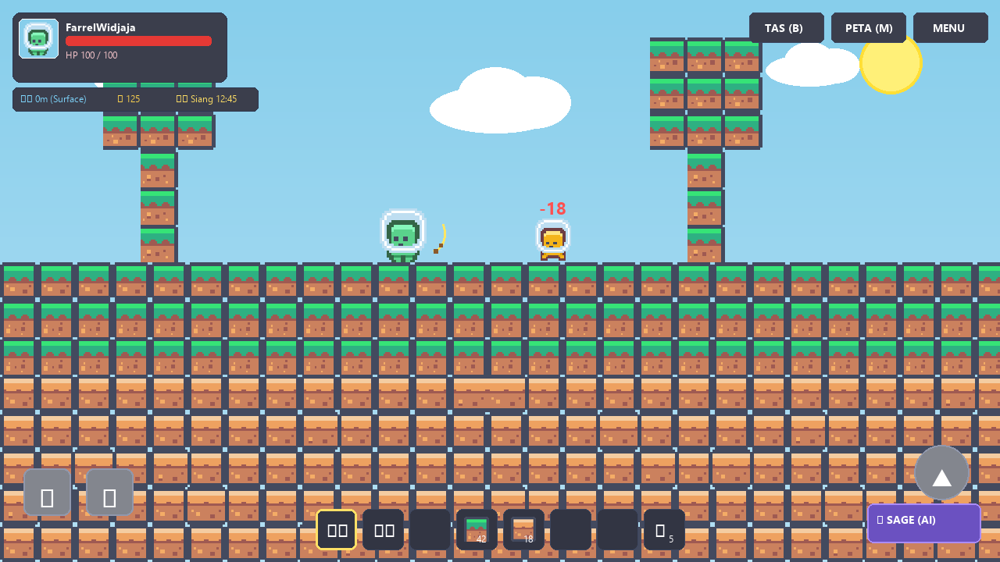
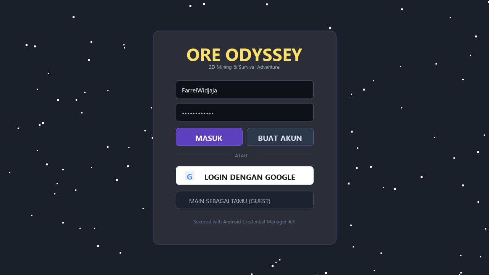
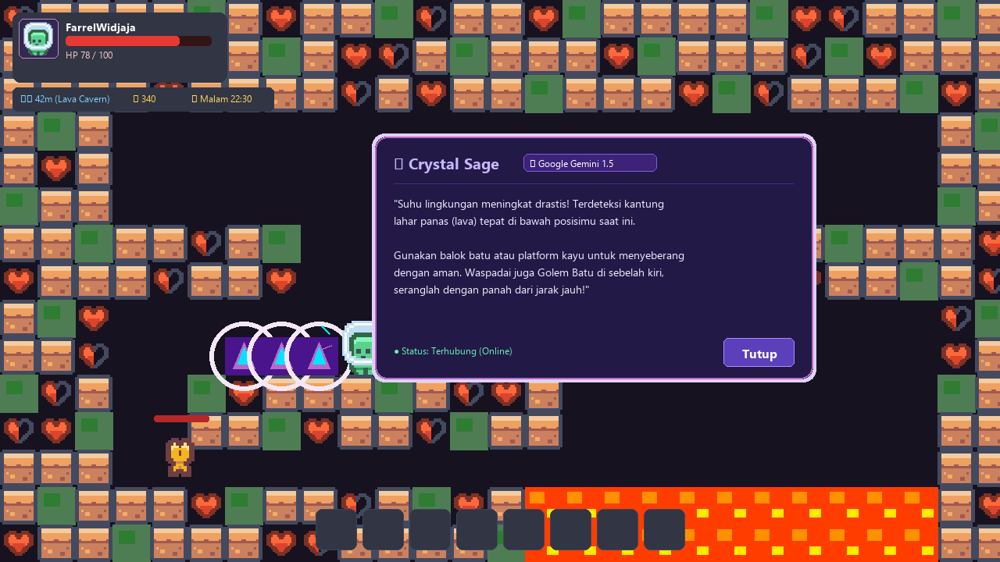

# 💎 Ore Odyssey

<p align="center">
  
</p>

<p align="center">
  
  
  
  
  
</p>

**Ore Odyssey** adalah game 2D *sandbox mining, crafting, dan survival adventure* berbasis Android yang dikembangkan sepenuhnya menggunakan bahasa **Kotlin**. Game ini memadukan eksplorasi dunia bawah tanah prosedural (*procedural world generation*), sistem pertarungan dinamis, kustomisasi karakter visual, tata suara multi-bioma adaptif, serta asisten petualangan pintar berbasis **Google Gemini AI** bernama *Crystal Sage*.

---

## 📸 Tampilan Antarmuka (Screenshots)

Berikut adalah dokumentasi tampilan antarmuka game pada berbagai kondisi permainan:

| 1. Layar Autentikasi & Login | 2. Eksplorasi & Menambang di Permukaan | 3. Gua Magma & Asisten AI Crystal Sage |
| :---: | :---: | :---: |
|  |  |  |
| *Antarmuka login aman dengan Android Credential Manager & Guest Mode.* | *Dunia permukaan dengan siklus siang/malam, pohon, monster, & HUD.* | *Bioma gua kristal ungu, danau lava, serta dialog pintar Gemini AI.* |

---

## 🌟 Fitur-Fitur Utama

### 1. 🗺️ Procedural World Generation & Chunk Loading
- **Simplex Noise (OpenSimplex2)**: Menghasilkan kontur tanah, bukit, jaringan gua bawah tanah, dan urat bijih tambang yang unik pada setiap seed baru.
- **Sistem Grid Chunk 16×16 & LRU Cache**: Pemuatan blok berbasis chunk asinkron di background thread (`Dispatchers.Default`) dengan batas memori aman hingga 160 chunk aktif.
- **Ragam Bioma Permukaan & Gua Bawah Tanah**:
  - *Permukaan*: Hutan lebat (*Forest*), Gurun berpasir (*Desert*), dan Tundra bersalju (*Tundra*).
  - *Bawah Tanah*: Gua Batu Standar, Gua Jamur Bercahaya (*Mushroom Grotto*), Gua Kristal Ungu (*Crystal Cave*), dan Gua Magma Panas (*Lava Cavern*).
- **Bahaya Lingkungan Interaktif**: Sengatan kaktus gurun berduri, risiko tenggelam di air, serta luka bakar akibat lahar panas (lava).

### 2. 🧙‍♂️ Pendamping Petualangan AI: *Crystal Sage*
- **Didukung Google Gemini AI (`gemini-1.5-flash`)**: Menganalisis kondisi pemain secara real-time—termasuk sisa HP, kedalaman tambang, waktu dunia (siang/malam), dan keberadaan monster di dekatnya—untuk memberikan saran survival kontekstual.
- **Sistem Fallback Offline Cerdas**: Jika koneksi internet terputus, game beralih otomatis ke *rule-based engine* lokal tanpa membuat game crash atau lagging.
- **Animasi Modern**: Indikator loading menggunakan **Facebook Shimmer Skeleton** dan ikon denyut energi berbasis **Airbnb Lottie Animation**.

### 3. ⚔️ Sistem Pertarungan & Ragam Monster
- **Varian Monster dengan Perilaku Unik**:
  - *Zombie*: Berpatroli lambat dan terbakar otomatis saat terkena terik matahari permukaan.
  - *Slime & Laba-laba*: Melompat melewati rintangan balok untuk mengejar pemain.
  - *Kelelawar (Bat)*: Terbang menembus ruang sempit di kedalaman gua.
  - *Golem Batu*: Monster tangguh dengan HP tinggi dan resistensi terhadap efek pentalan (*knockback*).
- **Mekanisme Tempur Lengkap**: Senjata jarak dekat (Pedang Kayu s.d. Berlian), senjata jarak jauh (Busur panah dengan lintasan fisika gravitasi), teks damage melayang (*Floating Damage Text*), dan tabel jarahan (*Loot Table*).

### 4. 🎨 Kustomisasi Karakter & HUD Terpadu
- **Kustomisasi Karakter Real-time**: Kostumisasi lengkap mencakup warna kulit, gaya & warna rambut, kemeja, celana/rok, serta jenis kelamin.
- **Avatar HUD Interaktif**: Karakter yang dirancang tampil langsung di pojok kiri atas layar permainan, bersanding dengan bar nyawa (HP), indikator kedalaman tambang (meter), jumlah koin, dan waktu permainan.

### 5. 🎵 Tata Suara Adaptif & BGM Multi-Bioma
- **Crossfading Halus Antar-Kedalaman**: Memadukan 3 trek musik Ogg Vorbis yang berputar mulus sesuai kedalaman pemain (*Surface*, *Cave*, *Deep Lava Cavern*) menggunakan `ValueAnimator`.
- **Pengaturan Audio Mandiri**: Dialog pengaturan audio dalam game dengan slider *SeekBar* terpisah untuk Master Volume, Musik BGM, dan Efek Suara (SFX).

### 6. ☁️ Cloud Save & Sinkronisasi
- **Format Penyimpanan Kompak**: Serialisasi status inventori, koordinat pemain, profil karakter, dan dunia ke format JSON terkompresi.
- **Resolusi Konflik Otomatis**: Mendeteksi versi penyimpanan terbaru berdasarkan stempel waktu (*timestamp*) antara penyimpanan lokal dan cloud.

### 7. ⚡ Optimasi Performa & Zero-Allocation Object Pooling
- **SpritePool Architecture**: Menghilangkan alokasi memori berulang (*garbage collection stutter*) untuk partikel debu galian, teks damage, panah tempur, dan tap point sentuhan.
- **Rendering 60 FPS Konstan**: Menggunakan zero-allocation array lookup pada canvas Android untuk pengalaman bermain yang responsif di berbagai spesifikasi ponsel.

---

## 🛠️ Tech Stack & Arsitektur

| Komponen | Teknologi |
| :--- | :--- |
| **Bahasa Pemrograman** | Kotlin (100% pure Kotlin) |
| **Arsitektur Kode** | Clean Modular Architecture (Game Loop, Entities, World, UI, Audio, Data) |
| **Platform Target** | Android 7.0 (API 24) s.d. Android 14 (API 34) |
| **Rendering Engine** | Custom Android Canvas Surface Game Loop & Pixel Tilemap Renderer |
| **AI Integration** | Google Generative AI SDK (`com.google.ai.client.generativeai`) |
| **Keamanan & Autentikasi**| AndroidX Credential Manager & AndroidX Security Crypto |
| **Animasi & UI** | Airbnb Lottie, Facebook Shimmer, AndroidViewAnimations (YoYo) |
| **Build System** | Gradle Version Catalog (`libs.versions.toml`) & Kotlin DSL (`build.gradle.kts`) |

---

## 🎮 Kontrol Permainan

| Tombol / Aksi | Kontrol Layar Sentuh | Pintasan Keyboard (Emulator / PC) |
| :--- | :--- | :--- |
| **Bergerak ke Kiri** | Tombol `◀` di kiri bawah | Tombol `A` atau Panah Kiri |
| **Bergerak ke Kanan** | Tombol `▶` di kiri bawah | Tombol `D` atau Panah Kanan |
| **Melompat** | Tombol `▲` di kanan bawah | Tombol `W` atau `Spasi` |
| **Gali / Pasang Balok** | Ketuk langsung pada balok di layar | Klik Kiri Mouse pada balok |
| **Menyerang Monster** | Ketuk langsung pada monster | Klik Kiri Mouse pada monster |
| **Buka Tas / Inventori** | Tombol `TAS (B)` di kanan atas | Tombol `B` |
| **Buka Peta Dunia** | Tombol `PETA (M)` di kanan atas | Tombol `M` |
| **Tanya Asisten AI** | Tombol melayang `🔮 SAGE` di kanan bawah | - |

---

## 🚀 Cara Menjalankan Project

### 1. Prasyarat
- **Android Studio** (Koala, Ladybug, atau versi yang lebih baru).
- **Java Development Kit (JDK)**: Versi 17 atau 21.
- **Perangkat Fisik / Emulator Android**: Minimal Android 7.0 (API level 24).

### 2. Kloning Repository
```bash
git clone https://github.com/farrelwidjaja/OreOdyssey.git
cd OreOdyssey
```

### 3. Konfigurasi Google Gemini API Key
Fitur asisten pintar *Crystal Sage* membutuhkan API key gratis dari Google AI Studio:
1. Kunjungi [Google AI Studio](https://aistudio.google.com/) dan buat API Key.
2. Buka atau buat file `local.properties` di folder utama (root) proyek `OreOdyssey/`.
3. Tambahkan baris berikut:
   ```properties
   GEMINI_API_KEY=masukkan_api_key_gemini_anda_di_sini
   ```
> **Catatan:** Jika Anda tidak mengisi API Key, game akan tetap berjalan dengan lancar menggunakan sistem *offline rule-based fallback*.

### 4. Build dan Jalankan Aplikasi
1. Buka folder `OreOdyssey` melalui **Android Studio**.
2. Tunggu proses **Gradle Sync** selesai mengunduh dependensi.
3. Sambungkan perangkat Android atau nyalakan Emulator.
4. Klik tombol **Run 'app'** (`Shift + F10`) pada toolbar Android Studio.

---

## 📂 Struktur Direktori

```text
OreOdyssey/
├── app/
│   ├── src/
│   │   ├── main/
│   │   │   ├── java/com/oreodyssey/game/
│   │   │   │   ├── ai/            # Google Gemini AI Companion, payload, & rule fallback
│   │   │   │   ├── audio/         # SoundManager, crossfading BGM, & efek suara Vorbis
│   │   │   │   ├── core/          # GameView (Surface loop 60 FPS), state, & kamera
│   │   │   │   ├── data/          # Profile, Palettes, Store, & CloudSaveManager
│   │   │   │   ├── entities/      # Player, Monster (AI varian), Panah, Item, & Inventori
│   │   │   │   ├── ui/            # CharacterPreview, TileRenderer, SpritePool, & dialog
│   │   │   │   ├── world/         # WorldMap, SimplexNoise, & ChunkLruCache grid system
│   │   │   │   ├── CharacterActivity.kt  # Layar pemilihan & kustomisasi hero
│   │   │   │   ├── LoginActivity.kt      # Layar masuk Google & akun lokal
│   │   │   │   └── MainActivity.kt       # Activity utama wadah GameView & HUD XML
│   │   │   └── res/
│   │   │       ├── drawable/      # Kenney tilemap packed & spritesheet karakter
│   │   │       ├── layout/        # activity_main.xml, activity_login.xml, dll.
│   │   │       ├── raw/           # BGM looping Vorbis & animasi Lottie json
│   │   │       └── values/        # Warna tema, style, dan resource teks
│   │   └── test/                  # Unit testing (Combat, WorldGen, Audio, AI, Save)
├── docs/
│   └── screenshots/               # Tangkapan layar dokumentasi aplikasi
├── gradle/
│   └── libs.versions.toml         # Gradle Version Catalog (dependensi terpusat)
└── README.md
```

---

## 📜 Atribusi & Lisensi

- Dikembangkan sebagai proyek aplikasi mobile **Semester 5 Mobile Programming**.
- **Aset Grafis Sprite**: Diadaptasi dari *Kenney Pixel Platformer (Public Domain / CC0)*.
- **Implementasi Noise**: Algoritma 2D Noise berbasis open-source *OpenSimplex2*.
- **Lisensi**: Proyek ini dilisensikan di bawah [MIT License](LICENSE).
